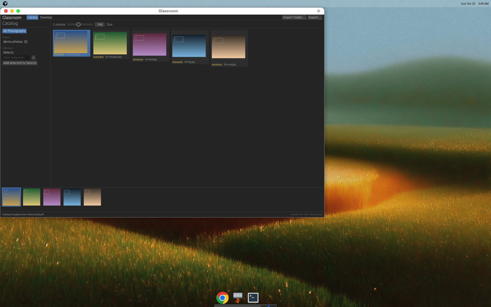
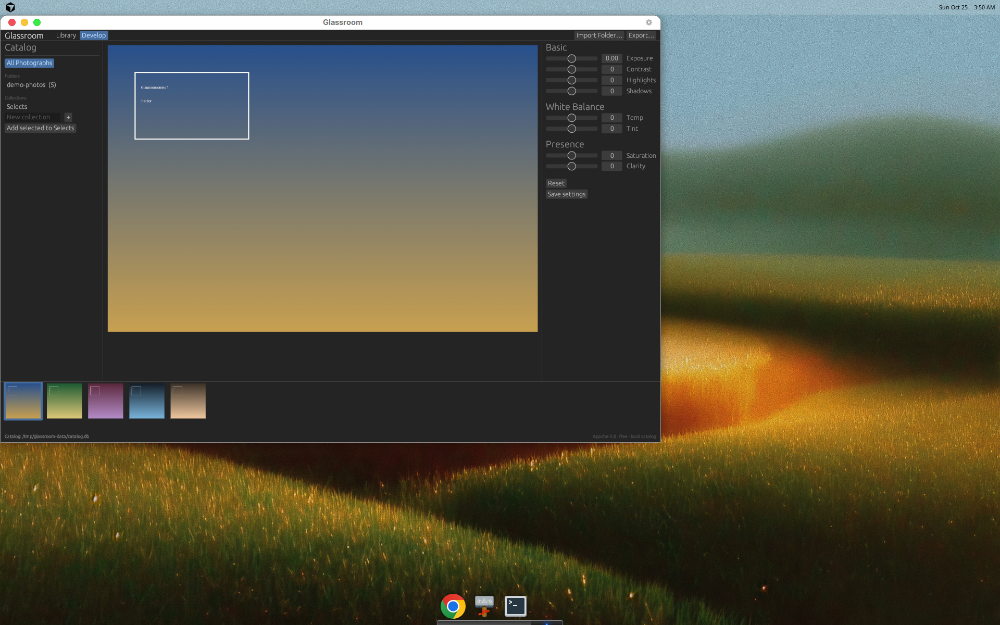

# Glassroom

**Glassroom** is a free, open-source desktop photo app with a Classic-style local catalog workflow: import JPEGs, cull in a library grid, develop non-destructively, and export baked JPEGs. Originals on disk are never overwritten.

- **License:** [Apache-2.0](LICENSE)
- **Platform:** macOS-first; Linux/dev preview works today
- **Pipeline:** JPEG-only for MVP (no RAW decode yet)
- **Monetization:** none — no accounts, paywalls, or required telemetry

This project is **not** affiliated with Adobe. UI strings and branding are original (no Adobe / Lightroom trademarks).

## Screenshots

### Library module

Dark Classic-style chrome: catalog sidebar, uniform thumbnail grid, filmstrip, **Import Photos…** / **Import Folder…** / **Export…** (demo catalog).



### Develop module

Non-destructive JPEG develop with loupe preview and Basic / White Balance / Presence controls.



## Try it on your Mac (recommended)

MVP ships as **source** you build once with Rust (no notarized `.dmg` yet).

1. Install Rust: https://rustup.rs  
   ```bash
   curl --proto '=https' --tlsv1.2 -sSf https://sh.rustup.rs | sh
   ```
2. Clone this repo:
   ```bash
   git clone https://github.com/ritwikraj16/Glassroom-Photoeditingsoftware.git
   cd Glassroom-Photoeditingsoftware
   ```
3. Build and run:
   ```bash
   cargo run --release
   ```
4. Click **Import Photos…** or **Import Folder…** and pick JPEGs from **your** desktop/drive.

Small demo JPEGs live in `demo-photos/` (generated gradients plus one aerial sample, [`06-coast-aerial.jpg`](demo-photos/06-coast-aerial.jpg)) for a quick test — not a full personal library:
```bash
./target/release/glassroom --import ./demo-photos
./target/release/glassroom
```

Catalog DB defaults to the app data dir (`Glassroom/catalog.db`). Override with `GLASSROOM_CATALOG=/path/to/catalog.db`.

### Compile vs launch (why it feels slow)

| What you run | What is slow |
|---|---|
| `cargo run --release` / first `cargo build --release` | **Compile** (minutes the first time). Not the same as app launch. |
| `open dist/Glassroom.app` or `./target/release/glassroom` | **Launch** only — should be seconds. Large catalogs fill thumbs lazily. |

**Day-to-day:** package once, then open the `.app` — do **not** run Cargo every time.

### macOS app (Dock / double-click)

On a Mac, after cloning:

```bash
chmod +x scripts/package-macos.sh
./scripts/package-macos.sh          # builds once, then wraps Glassroom.app
open dist/Glassroom.app
```

If the release binary already exists and you only need to refresh the `.app` wrapper:

```bash
./scripts/package-macos.sh --reuse-bin
```

Optional — install like other apps:

```bash
cp -R dist/Glassroom.app /Applications/
```

After that, open from Applications / Dock. Rebuild only after `git pull` when you want new code.

Bundle id: `app.glassroom.desktop` (original; not an Adobe vendor string).  
Icon: `assets/AppIcon.png` (packaged as `AppIcon.icns`).  
Unsigned local builds may need **right-click → Open** the first time.

### Linux (dev preview)

```bash
cargo run --release
```

## Features (MVP)

- Local SQLite catalog (path, star rating, pick/reject flag, collections)
- Import individual JPEGs or a whole folder
- Library: sidebar (folders / collections) + uniform thumbnail grid + filmstrip
- Develop: exposure, contrast, highlights/shadows, white-balance temp/tint, saturation, clarity
- Non-destructive edit params stored in the catalog; export writes a new JPEG
- Dark module chrome with Library / Develop switcher

## Usage

1. **Import Photos…** — pick one or more `.jpg` / `.jpeg` files, or **Import Folder…** for a whole directory.
2. Rate with `1`–`5`, clear with `0`; flag pick `P`, reject `X`, unflag `U`.
3. Switch to **Develop**, adjust sliders; preview updates; originals stay untouched.
4. **Export…** writes a baked JPEG (originals never overwritten).

## License

Copyright 2026 Glassroom contributors

Licensed under the Apache License, Version 2.0. See [LICENSE](LICENSE).
